<p align="center">
  
</p>

<p align="center">
  
</p>


<p align="center">
  
</p>

---

## whoami

<table>
<tr>
<td valign="middle">

```python
class Deepthi:
    """B.Tech CSE (AI & ML) @ PES University"""

    def __init__(self):
        self.role      = "Aspiring AI/ML Engineer"
        self.focus     = ["Agentic AI", "LLM APIs", "ML"]
        self.exploring = ["Multi-agent", "Tool use", "RAG"]
        self.based     = "Bengaluru, India 📍"
        self.hobby     = "Playing the keyboard 🎹"

    def currently(self):
        return "🌱 Code, curiosity & a little AI magic."
```

</td>
<td valign="middle" align="center">



<sub><i>✨ great things take time (and big nets take compute)</i></sub>

</td>
</tr>
</table>

---
## 🛠️ Tech Arsenal

<table>
<tr>
<td><b>💻 Languages</b></td>
<td>
   
</td>
</tr>
<tr>
<td><b>🎨 Frontend</b></td>
<td>
  
</td>
</tr>
<tr>
<td><b>⚙️ Backend & Databases</b></td>
<td>
   
</td>
</tr>
<tr>
<td><b>🤖 AI / ML</b></td>
<td>
 
</td>
</tr>
<tr>
<td><b>📊 Data & Analysis</b></td>
<td>
    
</td>
</tr>
<tr>
<td><b>🧰 Tools</b></td>
<td>
   
</td>
</tr>
</table>

<p align="center">
  
</p>

---

## 📊 GitHub Stats


<p align="center">
  
</p>

---

## 🤝 Let's connect

<p align="center">
  <a href="mailto:reachdeepthi.m@gmail.com">
    
  </a>
  <a href="https://www.linkedin.com/in/itsdeepthi/">
    
  </a>
  <a href="https://github.com/deepthi2225">
    
  </a>
  <a href="https://www.hackerrank.com/profile/pes1ug23am092">
    
  </a>
  <a href="https://leetcode.com/u/ikxLs8QsSK/">
    
  </a>
</p>

<p align="center">
  <i>"Keep shipping, keep learning."</i> 🚀<br/>
  Let's build something impactful, one commit at a time.
</p>

<p align="center">
  
</p>
